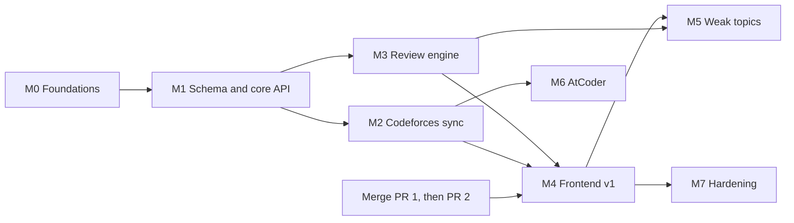

# Next-phase plan (draft for review)

Written overnight on 2026-11-25 by five read-only planning agents, then reconciled into one sequence. Nothing here is implemented or decided yet. Every default below is an assumption you can overturn; the ones that matter most are in [Decisions for you](#decisions-for-you).

| Appendix                                         | Area                                                                    |
| ------------------------------------------------ | ----------------------------------------------------------------------- |
| [A: schema](schema.md)                           | Tables, migrations SQL, verdict enum, core function signatures          |
| [B: sync](sync.md)                               | Codeforces and AtCoder APIs, HTTP client, sync algorithm, rate limits   |
| [C: review and insights](review-and-insights.md) | Failure definitions, review ladder, daily queue, weak-topic model       |
| [D: frontend](frontend.md)                       | Screens, navigation, per-screen state machines, `api.ts`, keyboard      |
| [E: shell and ops](shell-and-ops.md)             | Background sync, error kinds, SQLite ops, CSP, logging, CI, latent bugs |

## Where things stand

- `main` passes the full done gate: 8/8 steps, 3 Rust tests, 8 frontend tests. (In a fresh Linux container the Tauri system packages from `ci.yml` must be installed first, or clippy fails on `gdk-sys`.)
- Open PRs: #1 (Vite watcher) and #2 (design system). #2 contains #1's commits, so #1 merges first. #2 is finished but parked; nothing before milestone 4 needs it.

## The plan in brief

1. **Foundations first.** Fix five latent problems before the first new migration lands. The worst is that `pnpm tauri dev` and the release build share the real `kintsugi.db`, so a feature branch's migrations would lock the main-branch build out of your data.
2. **One timeline of facts, everything else derived.** Submissions (synced or manual) and an append-only log of your own actions are the only source data. Problem status, review schedule and topic scores are computed from them, so changing an algorithm means recomputing, not migrating.
3. **Codeforces end to end before anything else.** First usable slice: add a handle, sync, see your problems with verdicts. Then the Today review queue, then weak topics, then AtCoder.
4. **Small, boring algorithms for v1.** A fixed review ladder (3, 10, 30, 90 days) instead of FSRS, and a per-topic Elo-style estimate with a prior instead of raw solve rates. No new dependency for either.
5. **New dependencies, all to be justified in `decisions.md`:** `serde_json`, `reqwest` (rustls), core `tokio` (`time`, `sync`), `tauri-plugin-log`. Later, maybe `ts-rs` as a dev-dependency. No router, no chart library, no state library.

M2 and M3 can run in parallel once M1's submissions table exists. M4's first screens (shell, accounts, sync, problems list) only need M2; Today needs M3.

## Reconciled decisions

The planners disagreed in eight places. What I chose and why:

| Topic                   | Conflict                                                                                                                                          | Chosen                                                                                                                                                                                                                                         | Why                                                                                                                                                                                             |
| ----------------------- | ------------------------------------------------------------------------------------------------------------------------------------------------- | ---------------------------------------------------------------------------------------------------------------------------------------------------------------------------------------------------------------------------------------------- | ----------------------------------------------------------------------------------------------------------------------------------------------------------------------------------------------- |
| Timestamps              | A and E: ISO `TEXT`. B and C: unix-second `INTEGER`.                                                                                              | Store ISO-8601 UTC `TEXT` (the existing `activity_log` convention). Judge seconds go in via `strftime('%Y-%m-%dT%H:%M:%fZ', ?, 'unixepoch')`; queries feeding pure Rust logic select `unixepoch(col)` as `i64`. The frontend gets ISO strings. | One convention across every table, already recorded in `decisions.md`, readable in a DB browser. Bundled SQLite 3.51 has `unixepoch()`. Pure logic still works on `i64` with an injected `now`. |
| What "Repaired" means   | A: any failure before the first AC (WA then AC two minutes later is gold). C: a clean re-solve at least half a review interval after the failure. | C's definition. Problem status comes from the review fold, not from A's SQL CTE.                                                                                                                                                               | Gold should mean you came back and fixed it. Debugging a WA in the same sitting is not that. **Decision 1.**                                                                                    |
| Verdict model           | A: 8-key enum. B: adds Hacked and Skipped. C: accepted/rejected/ignored classes.                                                                  | A's 8-key enum (it matches `VerdictBadge`), with `raw_verdict` always stored. C's three classes are computed from the raw string per judge. CHALLENGED is rejected; CE and SKIPPED are ignored.                                                | The badge vocabulary stays small, and nothing is lost because the raw verdict is kept.                                                                                                          |
| Tag to topic mapping    | A: DB tables seeded by a migration. C: a Rust const table.                                                                                        | A's tables (`judge_tags`, `judge_tag_topics`, `problem_topics` overrides), seeded with C's mapping.                                                                                                                                            | You can remap tags and hand-tag AtCoder problems without a release.                                                                                                                             |
| Review storage          | A: generic JSON `state` plus `review_events`. C: append-only `owner_actions` plus a typed, rebuildable `review_state` cache.                      | C's design.                                                                                                                                                                                                                                    | Rebuilding from facts makes late syncs and late self-ratings correct, and typed columns are queryable.                                                                                          |
| Sync progress to the UI | D: a per-call `Channel`. B and E: global events.                                                                                                  | Event `sync://status` with a `seq` number, plus a `sync_status` command for the first render.                                                                                                                                                  | On-launch and periodic syncs have no frontend caller, so a Channel can't reach them.                                                                                                            |
| Error kinds             | Three different lists.                                                                                                                            | `databaseUnavailable`, `database`, `validation` (with optional `field`), `notFound`, `network`, `rateLimited`, `upstream`, `cancelled`, `internal`. `start_sync` returns `{ runId, alreadyRunning }` instead of an error.                      | Union of the lists, minus a "busy" kind nothing needs. Drift tests on both sides keep Rust and TS in step.                                                                                      |
| Problem ids             | D: strings like `codeforces:1850A`. A: integer row ids.                                                                                           | Integer ids as `number` in TS; `(judge, externalId)` stays the natural key.                                                                                                                                                                    | Matches the schema; no string parsing in the frontend.                                                                                                                                          |

Tables nobody fully owned, which I've added: `accounts` and `sync_state` (per B), `metadata_cache` (per B), and `settings` as a single-row typed `STRICT` table (`CHECK (id = 1)`) holding the daily cap, struggle threshold, session gap, auto-sync, theme and level override.

## Milestones and PRs

Each line is one small PR that passes the done gate on its own. Letters point to the appendix with the detail.

### M0 Foundations (no feature behaviour)

1. CI: run `push` only on `main` (PRs currently run twice), and `rust-cache` `save-if` main. (E)
2. `migration_count()` helper; replace the two hard-coded `applied_migrations == 1` asserts, which break on the next migration. (A, E)
3. Dev builds use `kintsugi-dev.db`, plus a `KINTSUGI_DB_PATH` override. **Must land before any feature migration.** (E)
4. `open()`: WAL, `synchronous = NORMAL`, explicit `foreign_keys` and `busy_timeout`. Refuse a database made by a newer app version. Back up with `VACUUM INTO backups/` before pending migrations, keeping 5. (A, E)
5. Errors: core `NotFound`, `Validation`, `Serialization` (adds `serde_json`); the unified `ErrorKind` with an exhaustive match; `DbState::pool()`; a TS `API_ERROR_KINDS` list; drift tests on both sides. (A, E)
6. ESLint: restrict every `@tauri-apps/*` import to `api.ts`. Today only `/core` is blocked, and the root package re-exports it. (D, E)
7. `tauri-plugin-log` and a panic hook. Remove `panic = "abort"` if you agree (decision 4). (E)
8. CSP and `devCsp`. Must be checked in `tauri dev` and a release build on Windows. (E)

### M1 Schema and core API

1. `judges` and `verdicts` tables; `verdict.rs` with the Codeforces and AtCoder mappings and failure classes. (A, C)
2. `problems` table, the `activity` module, `activity_log` indexes. (A)
3. `submissions` table, `import_submissions` (one transaction, idempotent on `(judge, external_id)`), manual attempts. (A)
4. Tags and topics tables, seed migration, owner overrides. (A, C)
5. `accounts`, `sync_state` and `settings` tables with their CRUD. (B)

### M2 Codeforces sync

0. **Check the Codeforces API and record fixtures.** codeforces.com didn't resolve from this cloud environment, so B's endpoint details come from memory. Either allow the host in the environment, or you run a few `curl` calls locally and commit trimmed responses.
1. `Fetcher` trait (native async-in-trait) plus `FakeFetcher`. (B)
2. Per-host rate limiter and backoff, tested with paused tokio time. (B)
3. Codeforces response types and parsing, using the fixtures. (B)
4. Backfill and incremental sync with progress, cancellation and resume after failure. (B)
5. Problemset metadata cache with a time-to-live. (B)
6. `ReqwestFetcher`. **Spike on Windows first:** aws-lc-rs needs the MSVC toolchain; the fallback is `ring` (decision 9). (B)
7. Shell: `SyncState` single-flight slot, `start_sync`/`cancel_sync`/`sync_status`, the `sync://status` event, `api.ts` wrappers. (B, E)

### M3 Review engine (pure Rust, parallel with M2)

1. Verdict classes and grouping submissions into attempts (4h session gap, one-WA slip). (C)
2. The ladder fold: Broken, Repaired, Mastered, Retired; the early-review rule. (C)
3. `build_queue`: overdue ratio order, daily cap minus reviews done today, local-day boundary from a passed-in UTC offset. (C)
4. `owner_actions` and `review_state` tables; rebuild run after each import. (C)
5. Commands `review_queue` and `record_owner_action`; problem status read from `review_state`. (C)

### M4 Frontend v1 (needs the design system)

0. Merge #1, rebase and merge #2, then its follow-ups:
   - `Tabs` renders only the selected panel;
   - an `other` verdict badge;
   - nav and action icons;
   - `Meter`, `Kbd` and `Alert` primitives;
   - move the dev link into the nav. (D)
1. App shell: a hand-rolled nav reducer with a back stack, sidebar, placeholder screens; Health moves to Settings > About. (D)
2. Settings: accounts and preferences. (D)
3. Sync indicator, refresh after sync through a `dataVersion` counter, sync on launch. (D, E)
4. Problems list with filters. (D)
5. Problem detail. (D)
6. Today: review queue with keyboard shortcuts 1–4 and J/K, and a live region announcing each action. (D)

### M5 Weak topics

1. Topic rating model: Elo-style, prior towards your level, 180-day recency half-life, bisection solver. (C)
2. Rating bands with Wilson lower bounds; "comfort ceiling". (C)
3. Insights query and command. (C)
4. Topics screen with CSS bars and "practice next" links to the Codeforces problemset filter. (C, D)

### M6 AtCoder

1. Sync through kenkoooo's AtCoder Problems API (1.5 s spacing; documented outages, so it must fail soft). Difficulty from `problem-models.json`. Left out of topic analytics until problems are tagged by hand. (B, C)

### M7 Hardening

1. Windows CI job (decision 7).
2. Periodic sync scheduler.
3. Export (`VACUUM INTO` to Downloads) and a diagnostics panel.
4. `ts-rs` dev-dependency once the DTOs settle.

Deferred past v1: LeetCode (needs session cookies, keychain storage and Terms of Service risk), installers, signing, the updater, charts over time, undo, the paper queue and habits.

## Decisions for you

Ordered by how much they change the work. The default is what the plan assumes if you say nothing.

| #   | Question                                                                                                          | Default assumed                                                                      |
| --- | ----------------------------------------------------------------------------------------------------------------- | ------------------------------------------------------------------------------------ |
| 1   | Is a WA then AC in the same sitting "Repaired" (gold), or only a clean re-solve days later?                       | Only a later clean re-solve. Same-sitting fixes stay "Broken" until reviewed.        |
| 2   | What counts as struggling? Does TLE count like WA? Do CE and SKIPPED count at all?                                | 2+ rejected submissions before AC. TLE/MLE/RE count like WA. CE and SKIPPED ignored. |
| 3   | Review ladder and load.                                                                                           | 3/10/30/90 days, mastered after 4 clean re-solves, 3 reviews a day.                  |
| 4   | Remove `panic = "abort"` from the release profile, so a crashing sync task doesn't silently kill the app?         | Yes, remove it.                                                                      |
| 5   | When does PR #2 merge? M4 can't start until it does.                                                              | After M0–M2, with D's follow-ups on top.                                             |
| 6   | Sync triggers.                                                                                                    | Manual, plus on launch if the last sync is over 15 min old. Periodic hourly in M7.   |
| 7   | Is the repo public? A Windows CI job costs 2× minutes on a private repo.                                          | Add the job in M7 either way.                                                        |
| 8   | Allow `codeforces.com` and `v2.tauri.app` in this cloud environment so agents can check docs and record fixtures? | Ask before implementing M2; otherwise you record the fixtures locally.               |
| 9   | If aws-lc-rs won't build on your Windows machine, is `ring` fine?                                                 | Yes.                                                                                 |
| 10  | Topic level: your live Codeforces rating, or inferred from your solves?                                           | Inferred, with an optional override in settings.                                     |
| 11  | AtCoder in weak-topic stats?                                                                                      | Excluded until you tag problems by hand.                                             |
| 12  | Bring back the opener plugin for "Open on judge"?                                                                 | No; copy the URL in v1.                                                              |
| 13  | Do gym, virtual and practice submissions count?                                                                   | Yes, all count the same.                                                             |
| 14  | Feature folders flat (`src/features/today/`) or under `src/features/tracker/`?                                    | Flat, one per domain. `tracker/.gitkeep` is removed.                                 |
| 15  | Cache the theme in `localStorage` so it doesn't flash at launch? (The database stays the source of truth.)        | Yes.                                                                                 |

Smaller questions are listed at the end of each appendix.

## Not verified

- **Codeforces API.** B's endpoint names, fields and verdict strings come from memory; only the 1-call-per-2-seconds limit was seen, in a search snippet.
- **AtCoder Problems.** Read from its `api.md`. Whether `from_second` is inclusive is unknown; the planned loop is safe either way.
- **Tauri docs.** The site didn't resolve. E checked permissions, events, Channels and CSP against the vendored `tauri-2.12.5` sources instead.
- **`tauri-plugin-log` and `ts-rs`.** Current versions and APIs were not checked.
- **CSP.** Not tried in a real window.
