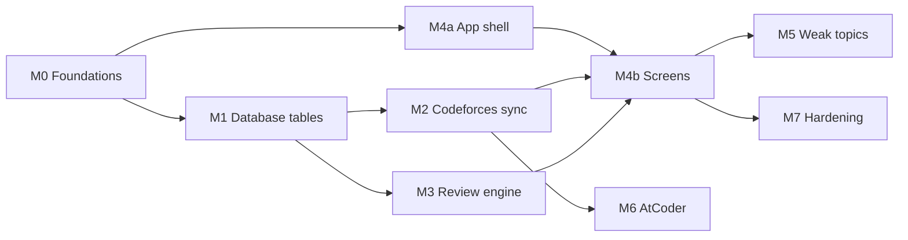

# Kintsugi: what we build next

This is the readable version of the plan. It says what gets built, in what order, and why. The detailed version, with the reasoning behind each choice, is [README.md](README.md). The SQL, function signatures and test lists are in the appendices it links to. Nothing here is built yet, and every default can be changed.

## Where the repo is today

Checked on 2026-11-26 against `main` at `a79db7d`.

- PRs #1 to #4 are merged, and there are no open PRs.
- The done gate passes: 8 of 8 steps, 3 Rust tests, 58 frontend tests.
- **What exists:**
  - the desktop shell and a database health check;
  - one table, `activity_log`;
  - the design system: tokens, 14 UI primitives and a dev review page;
  - guardrails:
    - Stylelint bans raw colors outside the tokens;
    - a test checks every UI component folder has its component and test files;
    - actionlint checks the CI workflows;
    - Prettier runs after each agent edit.
- **What doesn't exist yet:** judge accounts, syncing, problems, reviews, topic stats, and every screen except the health check.

## The idea in one paragraph

The app stores two kinds of facts:

- your **submissions**, synced from Codeforces or AtCoder, or logged by hand;
- your **own actions**, such as "skip this problem" or "I read the editorial".

Everything else is worked out from those facts: whether a problem is broken or repaired, when it is due for review, and which topics are weak. So when we improve an algorithm later, we recompute instead of migrating data. Codeforces works end to end first, because one judge you can actually use is worth more than two half-done.

## Words used in this plan

Attempt, failed, broken, repaired, mastered, retired, review ladder and weak topic are defined in the root [GLOSSARY.md](../../GLOSSARY.md).

## Order of work

In words:

1. M0 comes first.
2. Then three tracks can run side by side: M1 → M2, M1 → M3, and M4a.
3. M4b needs M2 and M3.
4. M5, M6 and M7 come last.

The first point where you can use the app for real is after M2 and the first screens of M4b: add your handle, sync, and browse your problems.

Each numbered item below is one small PR that passes the done gate by itself.

---

## M0: Foundations

**Spec:** [#7](https://github.com/23Nash/Kintsugi/issues/7)

**Goal:** fix problems in the current setup before any real data exists.

**Why first:** step 3 must land before any new database migration, or your real database is at risk.

1. **CI runs once per change.** Today every PR runs CI twice. Run on pushes to `main` and on PRs only, and keep the actionlint step.
2. **Tests stop counting migrations by hand.** Two tests expect exactly 1 migration and would break on the next one.
3. **The dev app gets its own database.** Today `pnpm tauri dev` opens your real `kintsugi.db`. A feature branch's migrations would then lock the normal app out of your data.
4. **Safer database settings.** Turn on WAL mode, so screens can read while a sync writes. Back up automatically before each migration, keeping 5 copies. Refuse to open a database made by a newer version of the app.
5. **One shared list of error types.** Rust and TypeScript use the same list, with a test on each side that fails if they drift apart.
6. **All Tauri calls go through `api.ts`.** Tighten the lint rule: today it only blocks one Tauri import path.
7. **Logging and crash reports.** Write logs to a file, and record panics instead of the app vanishing silently.
8. **Content security policy.** Stop the app window loading anything from outside the app. Check it in a real window on Windows.

**Done when:** the dev app uses its own database file, and a migration always makes a backup first.

## M1: Database tables and core functions

**Goal:** the tables and Rust functions every feature builds on.

1. **Judges and verdicts.** Codeforces and AtCoder are seeded. Each judge's verdict strings map to the 8 verdict kinds the UI shows.
2. **Problems.** Also add the activity-log helper.
3. **Submissions.** One import function, safe to run twice on the same data. You can also log attempts by hand.
4. **Tags and topics.** Codeforces tags map to about 20 topics. You can add or hide a topic on any problem.
5. **Accounts and settings.** Your judge handles, sync progress per account, and app settings such as the daily review cap.

**Done when:** a test can import a batch of submissions twice and get the same result.

## M2: Codeforces sync

**Goal:** press "Sync" and your Codeforces history arrives.

0. **Check the real Codeforces API first.** It was blocked from the cloud session, so details came from memory. Either allow `codeforces.com` for the session, or run a few `curl` calls locally and commit the responses as test fixtures.
1. **HTTP interface.** A small fetcher interface, so tests use saved responses and never touch the network.
2. **Rate limiting.** At most one Codeforces call every 2 seconds, with backoff when the API says to slow down.
3. **Read Codeforces responses.** Parse them into our types.
4. **The sync itself:**
   - the first sync downloads your full history;
   - later syncs fetch only what's new;
   - it can be cancelled, and it resumes cleanly after a failure.
5. **Problem ratings and tags.** Refreshed at most once a day.
6. **The real HTTP client.** Do one test build on Windows first. Build Tools 2026 is installed, so it should just work; the fallback is a different TLS library.
7. **Wire it into the app.** Commands to start, cancel and check a sync. A live status event lets every screen see the progress.

**Done when:** syncing your real handle twice in a row adds nothing the second time.

## M3: Review engine

**Goal:** decide which broken problems to re-solve today.

This is pure Rust with no UI, and it can be built alongside M2.

1. **Group into attempts.** Split submissions into attempts and judge each one: clean, struggled or failed.
2. **The review ladder.** Move problems between Broken, Repaired, Mastered and Retired.
   - A re-solve the same day or the next day is practice, not a review, so it doesn't turn gold by itself.
3. **Today's queue.** Most overdue first, capped at 3 a day by default, using your local day.
4. **Store the results.** Your actions are kept as a permanent log, and review state is recomputed after every sync.
5. **Commands for the UI.** Get today's queue and record what you did: solved, failed, skip, or snooze.

**Done when:** tests cover every move between states, using a fixed "now".

## M4a: UI follow-ups and app shell

**Goal:** the app frame you navigate in.

This needs only M0, so it can start early. New UI pieces must use the color tokens (Stylelint enforces this) and come with a test (the structure test enforces this).

1. **Design-system fixes:**
   - Tabs only render the open panel, so hidden screens don't load data;
   - an "other" verdict badge for Skipped, Hacked and judge errors;
   - nav icons;
   - small Meter, Kbd and Alert pieces.
2. **App shell:**
   - a sidebar with Today, Problems, Topics and Settings, and a Back button;
   - empty placeholder screens;
   - the health check moves to Settings > About;
   - the dev design-system link moves into the sidebar.

**Done when:** you can click around every section, even though each one is empty.

## M4b: Feature screens

**Goal:** the screens you use day to day.

1. **Settings.** Add and remove judge handles, and set preferences such as theme and daily cap.
2. **Sync indicator.** Shown in the sidebar. Screens refresh after a sync, and the app syncs on launch.
3. **Problems list.** Filters for judge, status and topic, plus search.
4. **Problem detail.** Every submission, the current status, and the next review date.
5. **Today.** The review queue, with keyboard shortcuts:
   - keys 1 to 4 for Solved, Failed, Skip and Snooze;
   - J and K to move between problems.

**Done when:** you can sync, open Today, and mark a review with the keyboard alone.

## M5: Weak topics

**Goal:** show which topics hold you back.

1. **Topic level estimate.** Your level per topic, based on the ratings of problems you solved or failed.
   - Recent problems count more.
   - Topics with few problems are pulled toward your overall level, so 2 lucky solves don't skew it.
2. **Rating bands.** How you do in each 200-point rating range, and the highest range where you're reliably comfortable.
3. **Command for the UI.** The topic report.
4. **Topics screen.** Bars per topic, and "practice next" links into the Codeforces problemset at the right rating.

**Done when:** the Topics screen ranks your topics, and topics with too little data are marked as such.

## M6: AtCoder

1. **Sync AtCoder.** Through the community AtCoder Problems API.
   - It is sometimes down for weeks, so a failure must never break anything else.
   - AtCoder has no tags, so its problems stay out of topic stats until you tag them yourself.

## M7: Hardening

1. **Windows CI job.** Catches problems that only happen on your platform.
2. **Periodic background sync.**
3. **Export and diagnostics.** Export your database to Downloads, and a panel showing file locations and versions.
4. **Generated TypeScript types.** Generated from Rust, once the data shapes settle.

**Not in v1:** LeetCode (needs your login cookies and risks its Terms of Service), installers and auto-update, charts over time, undo, the paper queue, and habits.

---

## Decisions you need to make

Each has a default the plan already assumes. You only need to answer where you disagree.

**These change the most:**

1. **Does fixing a WA in the same sitting count as Repaired (gold)?**
   Default: no, only a clean re-solve days later. The design system's wording ("failed, later accepted") would be tightened to match.
2. **What counts as struggling?**
   Default: 2 or more wrong submissions before AC. TLE, MLE and RE count like WA. Compile errors and Skipped don't count.
3. **Review ladder and daily load?**
   Default: 3, 10, 30 and 90 days, with 3 reviews a day.
4. **Remove `panic = "abort"` from the release build, so a crash gets logged instead of the app vanishing?**
   Default: yes.
5. **Build the app shell (M4a) alongside M1?**
   Default: yes.

**These can wait until their milestone:**

6. **Sync timing?** Default: manual, plus on launch if the last sync is over 15 minutes old. An hourly background sync comes in M7.
7. **Is the repo public?** A Windows CI job costs twice the minutes on a private repo.
8. **Allow `codeforces.com` and `v2.tauri.app` for cloud sessions?** Otherwise you record the API fixtures locally.
9. **If the default TLS library won't build on Windows, use `ring`?** Default: yes.
10. **Topic level: use your live Codeforces rating, or work it out from your solves?** Default: worked out, with a manual override in settings.
11. **Include AtCoder in topic stats?** Default: no, until you tag its problems.
12. **Add an "Open on judge" button?** It needs a Tauri plugin. Default: copy the URL instead.
13. **Count gym, virtual and practice submissions?** Default: yes, all the same.
14. **Feature folders?** Default: flat, one per feature, such as `src/features/today/`.
15. **Remember the theme in browser storage, so it doesn't flash at launch?** Default: yes.

## What hasn't been checked

- **Codeforces API.** The details were not checked against the live API; only the rate limit was seen.
- **AtCoder Problems API.** Read from its docs. One detail, whether `from_second` is inclusive, is unknown; the planned sync is safe either way.
- **Tauri docs.** The site was unreachable. The planner checked against the Tauri source code instead.
- **Logging plugin and type generator.** Their current versions were not checked.
- **Security policy.** Not yet tried in a real app window.
